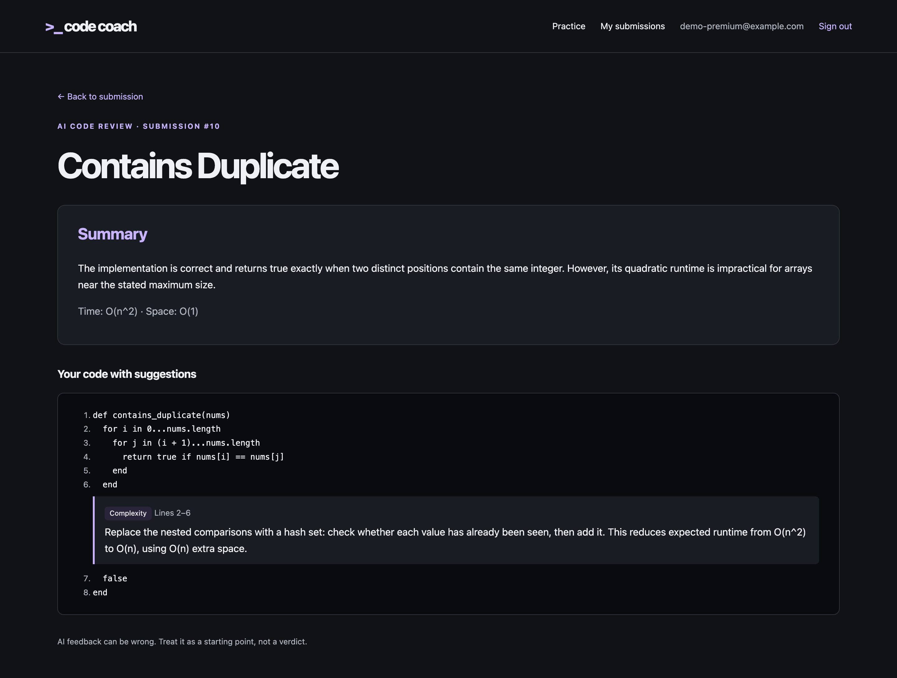
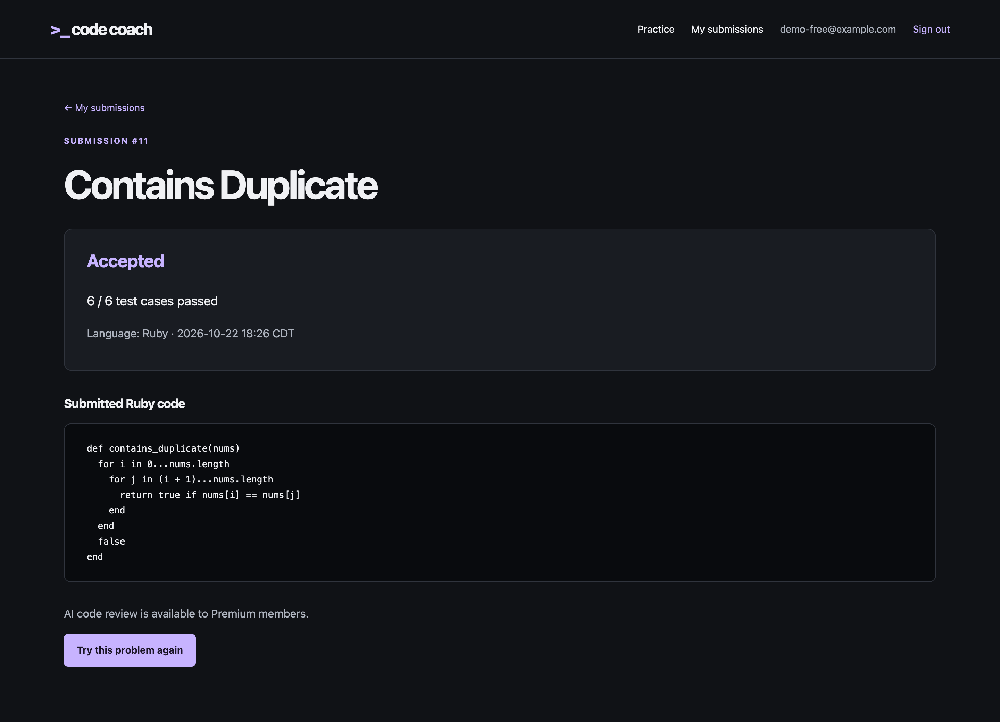

# User Guide

Create an account or sign in, then open **Roadmap & Practice**. Free and Premium
members have the same access to the roadmap and Ruby judge. These pages work
with JavaScript disabled.

## Choose a problem

The roadmap shows each topic's prerequisites and your current state:

- **Locked:** At least one prerequisite has not been mastered. Complete its
  problems first; direct links and submissions cannot bypass the lock.
- **In Progress:** The topic is unlocked and still has unsolved problems. An
  unlocked topic with no problems also stays In Progress.
- **Mastered:** Every problem in the unlocked topic has an Accepted submission
  from your account. Empty topics are never mastered.

Select an unlocked topic to see its curated problems, difficulty, and completion
status. **Not solved** means you have no Accepted submission for that problem.
**Accepted** means you have completed it; later unsuccessful retries do not
erase that completion. Another member's work never changes your progress.

Start with **Arrays & Hashing**. Mastering it unlocks **Two Pointers**, **Stack**,
**Binary Search**, and **Linked List**. Master **Two Pointers** to unlock
**Sliding Window**. Empty topics explain that no problems are available yet.

## Practice and review a submission

Open a problem, read its statement and examples, and complete the supplied Ruby
method. Select **Submit Ruby solution** to run the predefined cases. The result
shows the verdict, passed-case count, and your saved source code. A problem must
have at least five cases before it can be judged.

An Accepted solution updates your roadmap immediately. Wrong Answer,
Compilation Error, Runtime Error, and Timeout leave the problem unsolved unless
you previously solved it. If the judge is unavailable, your submitted code is
saved so you can retry later.

Use **My submissions** to revisit your own attempts. **Try this problem again**
restores your latest submitted code. Sign out when finished.

## AI code review (Premium)

After you submit a solution, Premium members can ask an AI reviewer for feedback on it. The review covers correctness, time and space complexity, missed edge cases, and code style problems.

### Getting a review

1. Submit a solution to any problem.
2. On the submission page, click **Get AI code review**.
3. The review page shows:
   - a **Summary** of how your solution does, with its time and space complexity;
   - **your code with line numbers**, with each suggestion placed directly under the lines it refers to;
   - **General suggestions** that apply to the whole solution, if there are any.

Each suggestion is labeled with its type (Correctness, Complexity, Edge case, or Anti-pattern) and the lines it refers to.

A correct and efficient solution may get no specific suggestions. AI feedback can be wrong, so treat it as a starting point rather than a final verdict.

### If the review is unavailable

If the AI service is down or sends back something the app can't use, you'll see "AI code review is unavailable right now." Your submitted code is saved, so you can try again later.

### Free members

Free members see "AI code review is available to Premium members." on the submission page instead of the review button. Everything else, including submitting solutions and seeing judge results, works the same.

